# Metin ve Zaman Serisi Füzyonu ile Hisse Senedi Oynaklık Sınıflandırması

**Multimodal Derin Öğrenme · Vize (Aşama 1): Veri Toplama, İnceleme ve Keşifsel Analiz**
Emirhan OKTAY · Kocaeli Üniversitesi, Bilişim Sistemleri Mühendisliği

| | |
|---|---|
| **Soru** | Bir şirketin kazanç çağrısı bittiğinde, hissenin sonraki günlerdeki oynaklığı düşük mü, orta mı, yüksek mi olacak? |
| **Görev** | 3 sınıflı sınıflandırma (düşük / orta / yüksek oynaklık) |
| **Modalite 1: metin** | Kazanç çağrısında yöneticilerin konuşmasının yazılı metni (MAEC) |
| **Modalite 2: zaman serisi** | Çağrıdan önceki 60 işlem gününün fiyat ve hacim serisi (FNSPID) |
| **Veri** | 3.443 çağrı → 3.026'sı eşleşti (%87,9) → temizlik sonrası **3.000 çağrı, 1.050 şirket** |
| **Sınıflar** | düşük 1.074 · orta 938 · yüksek 988 |
| **Ana bulgu** | Fiyat geçmişi güçlü bir ipucu; metin, fiyatın açıklayamadığı kısmı tamamlıyor |

> Şekil numaraları notebook'lardaki numaralardır. Hedefe (oynaklığa) dayanan bütün analizler yalnız **geliştirme
> döneminde** (çağrı tarihi ≤ 2016) yapıldı; **test dönemine** (2017 ve sonrası) hiç bakılmadı, model finalde ilk kez onunla sınanacak.

---

## 1. Problem ve Multimodal Yapı

**Problem.** Şirketler her üç ayda bir sonuçlarını **kazanç çağrısında** açıklar. Ardından hisse fiyatı normalden çok
daha fazla dalgalanır. Bu dalgalanmanın (**oynaklığın**) büyüklüğünü çağrı biter bitmez kestirmek risk yönetimi ve yatırım
kararları için önemlidir. Finansal metinden oynaklık tahmini bilinen bir araştırma problemidir (Kogan vd., 2009; Qin ve Yang, 2019).

**Hedef nasıl hesaplanıyor?**

| Gün −60 … −1 (çağrıdan önce) | Gün 0 (çağrı) | Gün 0 … +6 |
|---|---|---|
| **Girdi 1:** fiyat ve hacim serisi | **Girdi 2:** çağrının metni | **Hedef:** bu 7 günün oynaklığı → 3 sınıf |

- Oynaklık = gün 0..+6 günlük getirilerinin standart sapmasının logaritması.
- Sınıf sınırları yalnız eğitim verisinden, üçe eşit bölünecek şekilde belirlendi (−4,1394 ve −3,6080).
- Gün 0 ve +1 birlikte: borsa açılmadan önceki çağrılarda tepki gün 0'da, kapanıştan sonrakilerde gün +1'de gelir (Berkman ve Truong, 2009).
- Girdi gün −1'de biter, hedef gün 0'da başlar; ikisi hiçbir günü paylaşmaz (sızıntı yok).

**Modaliteler**

| | Metin (kazanç çağrısı) | Zaman serisi (fiyat/hacim) |
|---|---|---|
| **Taşıdığı bilgi** | Yönetimin açıkladığı içerik: sonuçlar, ürünler, beklentiler, iş modeli | Hissenin çağrı öncesi davranışı: getiri, işlem ilgisi, gün içi belirsizlik |
| **Ham biçim** | Çağrı başına `text.txt`, satır başına bir cümle | Hisse başına CSV: tarih, açılış, yüksek, düşük, kapanış, düzeltilmiş kapanış, hacim |
| **Boyut** | 3.443 çağrı, 394.277 cümle; medyan 1.931 kelime | 7.693 hisse dosyası |
| **Model girdisi** | Temizlenmiş cümle listesi (21–9.081 kelime) | 60 gün × 3 kanal: getiri, göreli hacim, gün içi aralık |
| **Özellik** | Yalnız yönetim konuşması; kişi adları maskeli | Günlük, takvimle hizalı, eksik gün yok |

**Neden multimodal?**

- **Yalnız fiyat yetmez:** fiyat geçmişi hissenin ne kadar oynak olduğunu bilir (geçmiş ve gelecek oynaklık arasında
  ρ = 0,489) ama çağrıda ne açıklandığını bilmez.
- **Yalnız metin yetmez:** metin ne açıklandığını taşır ama hissenin normalde ne kadar oynak olduğunu bilmez.
- **İkisi aynı olayı anlatır:** her çağrının metni ve fiyat serisi aynı şirket ve aynı gün üzerinden eşleştirildi
  (Şekil 4). Örnek: BGFV'de fiyat geçmişi sakindi ama metin sinyali uçtaydı ve fiyat ertesi gün yaklaşık %29,4 düştü;
  LXU'da metin çok olumluydu ama fiyat zaten alarm veriyordu ve çağrı gününde yaklaşık %44 düştü (Şekil 24).

---

## 2. Veri Kaynakları ve Toplama Süreci

| Modalite | Kaynak | Sabit sürüm | Lisans |
|---|---|---|---|
| Metin | [MAEC](https://github.com/Earnings-Call-Dataset/MAEC-A-Multimodal-Aligned-Earnings-Conference-Call-Dataset-for-Financial-Risk-Prediction) — Li vd., CIKM 2020 | commit `65a109f` | CC BY-SA 4.0 |
| Fiyat | [FNSPID](https://huggingface.co/datasets/Zihan1004/FNSPID), yalnız `Stock_price/full_history.zip` — Dong vd., KDD 2024 | revizyon `bf9189c` | CC BY-NC 4.0; kaynağı Yahoo Finance, yeniden dağıtılamaz |
| Yardımcı: duygu sözlüğü | [Loughran–McDonald](https://sraf.nd.edu/loughranmcdonald-master-dictionary/) 1993–2025 | SHA256 kontrollü | Akademik kullanım ücretsiz |
| Yardımcı: şirket adı, sektör | SEC EDGAR API (kendi topladığımız) | Kasım 2026 | Kimlik bildirimi, saniyede ≤ 10 istek |

- **Nasıl elde edildi:** `src/indir.py` dosyaları sabit sürümden indirir ve SHA256 özetiyle doğrular. MAEC'te her çağrı
  `YYYYMMDD_TICKER` adlı bir klasördür; sayılar makaledekiyle birebir aynı (3.443 çağrı, 1.213 şirket, 394.277 cümle).
  MAEC'teki ses özellikleri kullanılmadı: proje metin + fiyat serisi çiftine odaklanır.
- **Karşılaşılan sorunlar:** FNSPID zip'inde 7.694 gereksiz `__MACOSX` dosyası; dosyalarda iki farklı sütun sırası;
  7.620 dosyada tarihler tersten sıralı; bazı fiyat dosyaları kesik (6 çağrı düştü); SEC listesi güncel olduğu için
  borsadan çıkmış şirketler yok. Hepsi kodda çözüldü ya da raporlandı.
- **Etik ve lisans:** ham veri depoda paylaşılmaz, yalnız indirme kodu. Kişi adları MAEC'te maskeli (her yerde tam değil). FNSPID'in GitHub
  sayfasındaki 2025 duyurusu lisans dosyasıyla çelişiyor; tutucu olarak CC BY-NC 4.0 uygulandı.
- **İzlenebilirlik:** her örneğin kimliği MAEC klasör adıdır; birleştirme kuralı "klasör adındaki kod = fiyat dosyasının adı".

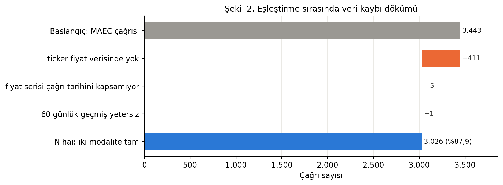

| Adım | Düşen | Kalan |
|---|---:|---:|
| MAEC çağrısı (başlangıç) | — | 3.443 |
| Ticker fiyat verisinde yok | 411 | 3.032 |
| Fiyat dosyası kesik / geçmiş yetersiz | 6 | 3.026 |
| Metni içeriksiz (≤ 20 kelime, temizlikte) | 26 | **3.000** |

---

## 3. Veri Miktarı, Dağılım ve Temsil Gücü

| Sınıf | Tümü | % | Geliştirme (≤ 2016) | Test (2017–2018) |
|---|---:|---:|---:|---:|
| Düşük | 1.074 | 35,8 | 622 | 452 |
| Orta | 938 | 31,3 | 622 | 316 |
| Yüksek | 988 | 32,9 | 622 | 366 |
| **Toplam** | **3.000** | 100 | **1.866** | **1.134** |

Ders şartı (en az 3 sınıf, sınıf başına en az 150, toplam en az 500) rahatça sağlanıyor: en küçük sınıf 938.

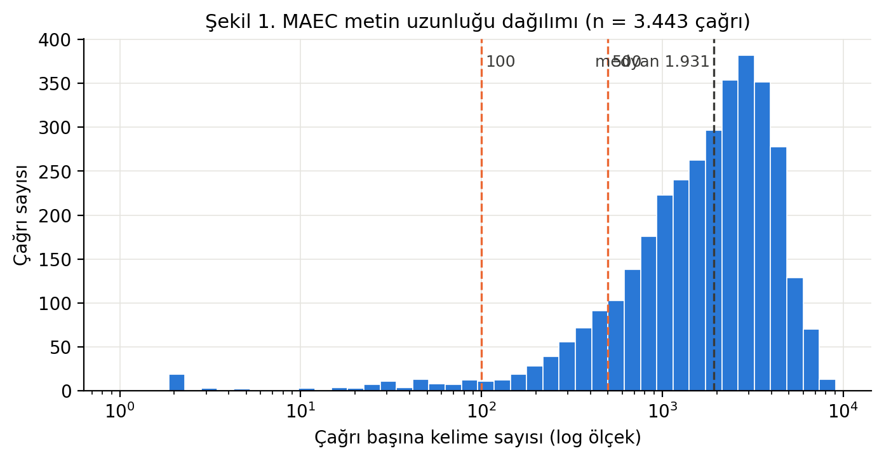

**Metin uzunluğu:** medyan 1.931 kelime, sağa çarpık. 98 çağrı 100 kelimeden kısa; 2 kelimedeki küçük tepe, metni
yalnız "Thank you." olan 19 çağrı. Bu yüzden temizlikte boş metinler çıkarıldı.

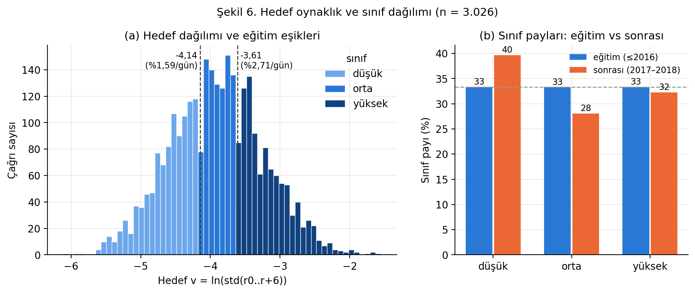

**Hedef dağılımı:** tek tepeli ve neredeyse simetrik; sınıf sınırları dağılımı üçe böler.
**Zaman serisi uzunluğu:** her çağrıda girdi sabit 60 gün ve hiçbir pencerede eksik gün yok; doldurma gerekmedi.

**Temsil gücü ve olası yanlılıklar**

- **Evren ve zaman:** ABD'deki S&P 1500 şirketleri, 2015–2018. Sınıf payları zamanla kayıyor (2016'nın ilk çeyreğinde
  yüksek sınıf %51,5) → piyasa dönemi etkisi var.
- **Şirket:** 1.050 şirket, şirket başına 1–10 çağrı. Aynı şirketin çağrıları birbirine benzer → bölme şirkete göre yapıldı.
- **Sektör:** en büyük sektör imalat (%31,8); çağrıların %21,8'inin sektörü bilinmiyor.
- **Hayatta kalma yanlılığı:** eşleşmeyen 158 şirketin 116'sı (%73,4) bugün SEC listesinde yok; sonradan borsadan çıkan
  şirketler eksik temsil ediliyor.

---

## 4. Modalite Eşleştirme ve Etiket Kalitesi

**Eşleştirme mantığı:** anahtar = borsa kodu + çağrı tarihi. Çağrı ile fiyat penceresi **bire bir**, şirket ile çağrı
**bire çok**. Olay günü (gün 0) = çağrı tarihi ya da sonraki ilk işlem günü. 3.443 çağrının 3.026'sı eşleşti (%87,9).

**Eşleşme doğru mu? Üç kanıt:**

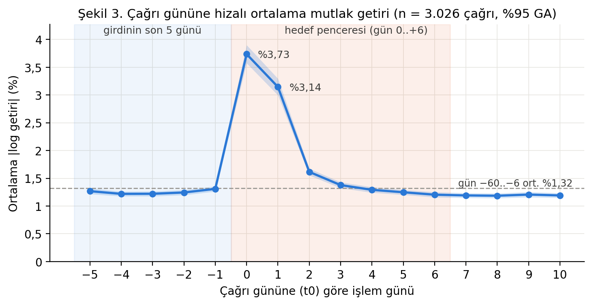

**1. Fiyat tam çağrı gününde sıçrıyor:** sıradan günlerde ortalama hareket %1,39, çağrı günü %3,81, ertesi gün %3,19.
Tarihler kaymış olsaydı sıçrama bu günlerde olmazdı. Girdinin son günü (gün −1) normal; yani girdiye sızan bir tepki yok.

**2. Gerçek örnekler:** her sınıftan bir çağrı kuralla seçildi. Fiyat ve metin aynı olayı anlatıyor: Lowe's (düşük)
hava koşullarını anlatıyor, fiyat çağrıdan sonra kademeli yükseliyor; Park Electrochemical (yüksek) çağrı gününde
sıçrayıp ertesi gün geri dönüyor.

**3. Şirket adı kontrolü:** SEC adı bulunan 2.367 çağrının %64,1'inde şirketin kendi adı metinde geçiyor; başka bir
şirketin adı yalnız %3,7'sinde geçiyor. Bu kontrol bir sorunu da buldu: SEC listesi ECHO kodunu bugünkü sahibine
(EchoStar) bağlıyor ama metinler bir lojistik şirketini anlatıyor; kod sonradan el değiştirmiş. Bu yalnız SEC'ten gelen
adı/sektörü etkiliyor, fiyat–metin eşleşmesini değil.

**Etiketin kökeni ve kalitesi:** etiketi insan vermiyor, fiyattan formülle hesaplanıyor.

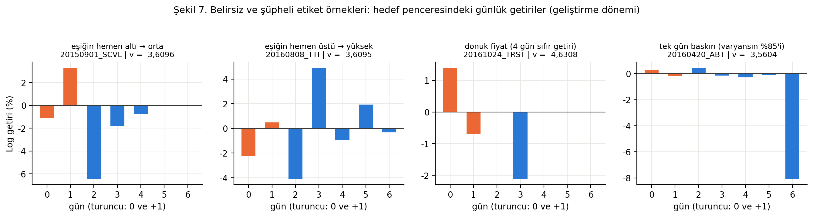

- **Belirsiz etiketler:** çağrıların %23,6'sı bir sınıf sınırına çok yakın; ilk iki örnek sınırın iki yanında ve
  oynaklıkları neredeyse aynı. → Finalde sınıflandırmanın yanında sürekli değerle regresyon da raporlanacak.
- **Tek gün baskınlığı:** 7 günlük dalgalanmanın medyan %53'ü tek günden geliyor (çoğunlukla gün 0 ya da +1).
- **Donuk fiyat:** 2 çağrıda en az 3 gün fiyat hiç değişmemiş; işlem hacmi olduğu için gerçek, hata değil.

**Eksik modalite:** metni eksik çağrı yok; 417 çağrıda (%12,1) fiyat yok ya da yetersiz; 20 eşleşmiş çağrının metni
fiilen boş. Füzyon iki modaliteye birlikte ihtiyaç duyduğu için iki modalitesi de tam olan çağrılar kullanıldı; fiyat
uydurulamayacağı için eksik fiyat doldurulmadı.

---

## 5. Veri Temizleme ve Ön İşleme

| Sorun | Ölçüm | Karar |
|---|---|---|
| İçeriksiz metin (≤ 20 kelime) | 26 çağrı | Çıkarıldı |
| Tekrar kayıt (aynı şirketin çağrıları arasında en yüksek benzerlik) | 0,101 | Kopya yok |
| Yazıya dökenin notu (`[indiscernible]`, `(ph)`) | 1.132 | Silindi |
| Köşeli parantezli ekleme (`[million]`) | 1.867 | Parantez kaldırıldı |
| Maskeli ad / URL / tipografik karakter | 29.465 / 161 / 4.503 | Tek biçime getirildi |
| Uç getiri (günlük log getiri 0,4'ten büyük) | 10 çağrı-gün | İncelendi, gerçek; korundu |
| Sıfır getirili günler | 27 çağrı | İncelendi, gerçek; korundu |

**Yöntemler.**
- **Metin:** yalnız konuşma olmayan işaretler temizlendi. Küçük harfe çevirme, durak kelime silme bilerek yapılmadı:
  bu adımlar kullanılacak modele bağlı ve erken yapılırsa geri alınamaz.
- **Fiyat:** fiyatın kendisi modele verilmez (hisseler arası ölçek çok farklı ve düzeltilmiş fiyat geriye dönük değişiyor).
  Yerine üç ölçekten bağımsız kanal üretildi: günlük getiri, göreli işlem hacmi, gün içi aralık (yüksek/düşük).

**Öncesi–sonrası 1: boş metinlerin çıkarılması**

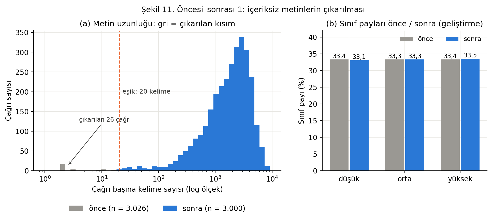

26 çağrı (%0,86) çıktı; sınıf payları en çok 0,23 puan değişti. Kayıp küçük ve dengeyi bozmuyor.

**Öncesi–sonrası 2: metin gürültüsü**

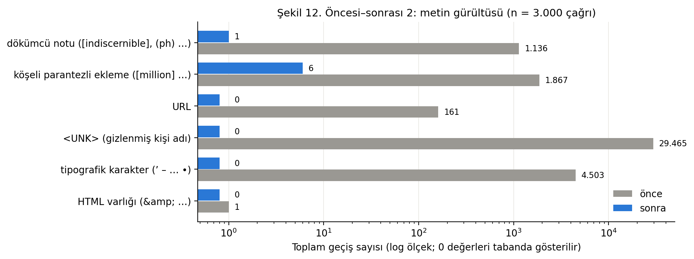

Notlar 1.132'den 1'e, eklemeler 1.867'den 6'ya indi; kelime kaybı binde birin altında.

**Öncesi–sonrası 3: fiyat serisinin ölçekten arındırılması**

Ham seride ortalama fiyat 1,98 $ ile 1.869,43 $ arasında (942 kat). Dönüşümden sonra bütün hisseler aynı ölçekte.
Kaybedilen bilgi şirket büyüklüğü ve fiyat düzeyi; sızıntı riski yüzünden bilerek atıldı.

**Aykırı değer analizi:** günlük log getirisi 0,4'ü aşan 10 çağrı-günün işlem hacmi olağanın 3,3–43,6 katı. Bölünme
hatası böyle hacim üretmez; bunlar gerçek, haber kaynaklı hareketler ve veride bırakıldı.

---

## 6. Keşifsel Veri Analizi (EDA)

**Metin modalitesi: duygu tonu**

Olumlu/olumsuz/belirsiz kelime oranları üç sınıfta neredeyse aynı. Yani metindeki bilgi duygu tonunda değil, ne
anlatıldığında. Yüksek oynaklıkta ürün ve satış dili (gross, inventory, sales), düşükte büyük ölçek ve finans dili
(billion, acquisitions) daha sık geçiyor.

**Zaman serisi modalitesi: fiyat geçmişi**

Gün içi aralık ve 60 günlük geçmiş oynaklık sınıfları açıkça ayırıyor: çok dalgalanan hisse çağrıdan sonra da çok
dalgalanıyor. Son 5 günün işlem hacmi ise neredeyse ayırt edici değil.

**Modaliteler arası ilişki: metin fiyatı tamamlıyor mu?**

Her çağrı için metni en çok benzeyen 10 başka şirketin çağrısı bulundu (TF-IDF benzerliği) ve onların ortalama
oynaklığı "metin sinyali" olarak alındı.

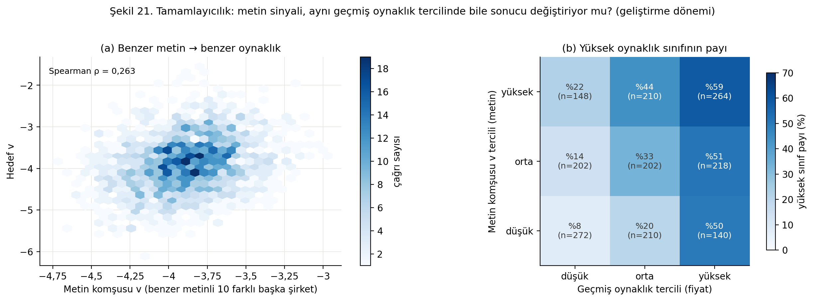

Fiyat geçmişi aynı olan hisseler arasında bile metin sinyali yükseldikçe yüksek oynaklık payı artıyor (ör. orta grupta
%20,0'dan %43,8'e). Fiyat ve piyasa etkisi çıkarıldıktan sonra da ilişki sürüyor (kısmi ρ = 0,167, %95 GA 0,123–0,212);
15 farklı ayarda ve rastgele karıştırma testinde (p = 0,001) bulgu korunuyor. **İki modalite birbirini tamamlıyor.**

**Aykırı durum ve örnek olaylar**

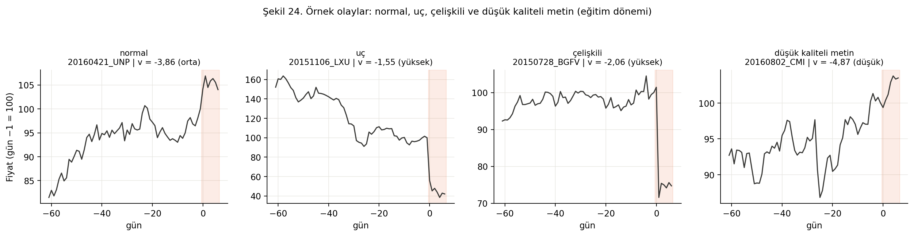

Kuralla seçilen dört çağrı: **normal** (UNP) her ölçüde ortada; **uç** (LXU) fiyat zaten alarm veriyordu ve çağrı
gününde yaklaşık %44 düştü; **çelişkili** (BGFV) fiyat sakindi ama metin sinyali uçtaydı ve fiyat ertesi gün yaklaşık
%29,4 düştü; **düşük kaliteli metin** (CMI) 21 kelimelik teşekkür metni, bilgi taşımıyor. LXU'yu fiyat, BGFV'yi metin
yakalayabilirdi.

**Verinin güçlü ve sınırlı yönleri**

- **Güçlü:** eşleşme doğrulandı; sınıflar dengeli ve örnek sayısı şartın çok üstünde; fiyat güçlü bir taban; metin fiyatın üstüne bilgi ekliyor.
- **Sınırlı:** duygu tonu işe yaramıyor; metin sinyalinin bir kısmı sektör bilgisi; hedefin bir kısmı piyasa havası
  (aylık ρ = 0,456); metin yalnız yönetim konuşması; çağrı saati veride yok; tek dönem ve yalnız ABD.

---

## 7. Modellemeye Hazırlık ve Veri Bölme

**Neden rastgele 5 kat değil?** (1) Aynı şirketin çağrıları birbirine benzer; şirket iki tarafa düşerse model şirketi
ezberler. (2) Çağrılar aynı haftalarda yığılır, piyasa havası iki tarafta paylaşılır. (3) Gelecekten öğrenip geçmişi
tahmin etmek gerçekçi değil. Bu yüzden üç düzen birlikte kullanıldı:

| Düzen | Nerede | Ne için |
|---|---|---|
| **Test** | 2017 ve sonrası (1.134 çağrı) | Geleceğe genelleme; finalde yalnız bir kez açılır |
| **Şirket katları** (StratifiedGroupKFold, 5 kat) | Geliştirme (1.866 çağrı) | Yeni şirkete genelleme; model seçimi |
| **İleri katlar** (2016'nın 4 çeyreği) | Geliştirme | Zamanda ileriye genelleme |

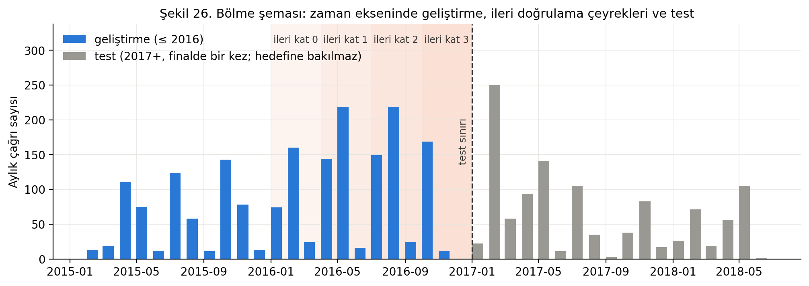

- Şirket katlarında eğitim ve doğrulamada **ortak şirket 0**; her katta sınıflar yaklaşık 125 / 125 / 125.
- Bir çağrının metni ve fiyat serisi **her zaman aynı kattadır**.
- Sınıf sınırları, ölçekleme ve metin sözlüğü her katta **yalnız eğitim kısmından** öğrenilir.
- Geliştirme ile test arasında 55 günlük boşluk var; test şirketlerinin 135'i hiç görülmemiş yeni şirket.

**Modelin göreceği tek bir örnek:**

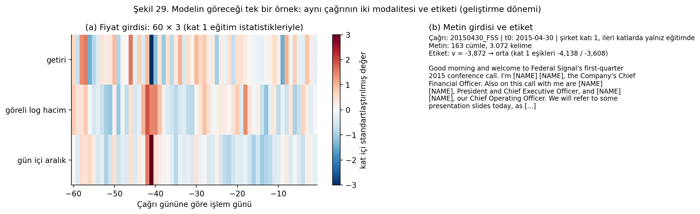

| Girdi | Biçim |
|---|---|
| Metin | Temizlenmiş cümle listesi |
| Fiyat | 60 gün × 3 kanal dizisi, `(3.000, 60, 3)` |
| Etiket | Sınıf (0/1/2) ve sürekli oynaklık değeri |

**Final planı:** yalnız fiyat (1D-CNN / LSTM), yalnız metin (TF-IDF, dil modeli) ve ikisinin füzyonu (erken, geç, ara
füzyon) karşılaştırılacak; ölçüt makro-F1. Metnin katkısı "yalnız fiyat" ile "fiyat + metin" farkıyla ölçülecek.

---

## 8. Kod

| Notebook | Ne yapıyor |
|---|---|
| `01_veri_edinme_eslestirme` | Veriyi okur, çağrıyı fiyatla eşleştirir, etiketleri ve veri özetini çıkarır |
| `02_temizlik_on_isleme` | Metni ve fiyat serisini temizler, öncesi–sonrası karşılaştırmaları yapar |
| `03_kesifsel_analiz` | Modalite bazında ve modaliteler arası analizler, örnek olaylar |
| `04_bolme_sizinti` | Test ayrımı, şirket ve ileri katlar, sızıntı kontrolleri |

Ortak kod `src/` klasöründe, 29 grafik `sekiller/`, özet tablolar `cikti/` klasöründe. `tests/` altındaki 24 test,
sonuçları bağımsız olarak yeniden hesaplayıp sızıntı kurallarını kontrol ediyor; hepsi geçiyor.
Veriler lisans gereği depoda yok; `src/indir.py` aynı sürümü kaynağından indirir.

## Kaynaklar

- Li vd. (2020). MAEC: A multimodal aligned earnings conference call dataset for financial risk prediction. *CIKM*.
- Dong vd. (2024). FNSPID: A comprehensive financial news dataset in time series. *KDD*.
- Loughran ve McDonald (2011). When is a liability not a liability? *Journal of Finance*.
- Kogan vd. (2009). Predicting risk from financial reports with regression. *NAACL*.
- Qin ve Yang (2019). What you say and how you say it matters. *ACL*.
- Berkman ve Truong (2009). Event day 0? After-hours earnings announcements. *Journal of Accounting Research*.
