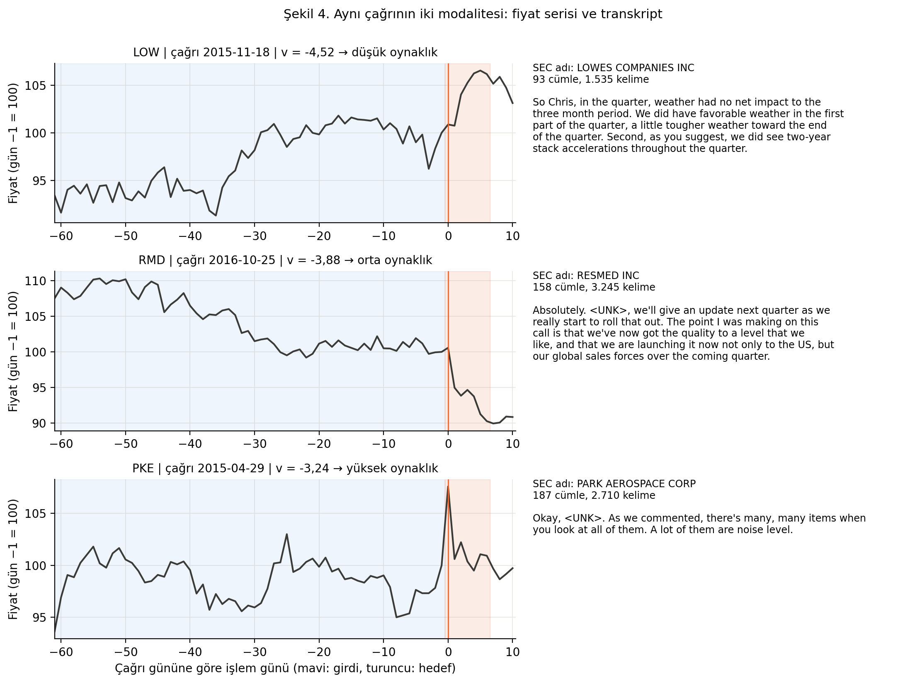
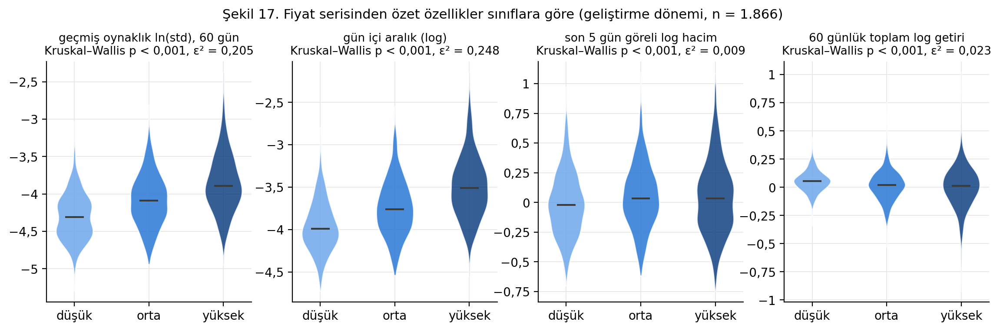
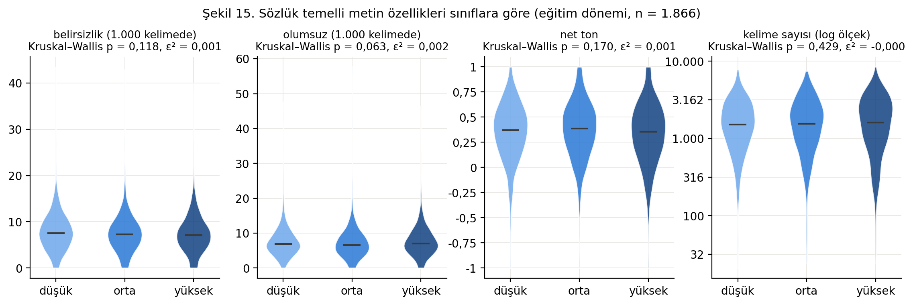
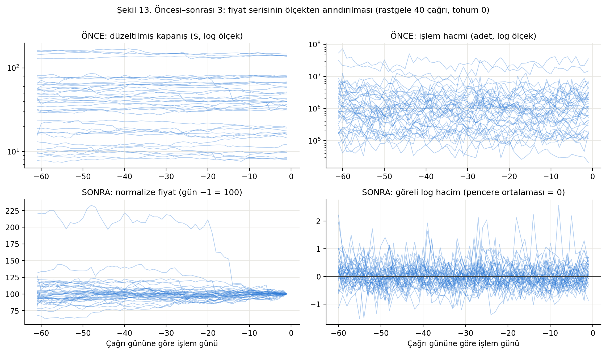

# Kazanç Çağrısı ve Fiyat Serisiyle Hisse Oynaklığı Tahmini

**Multimodal Derin Öğrenme dersi projesi · Vize aşaması: veri toplama, inceleme ve modele hazırlık**

Şirketler her üç ayda bir sonuçlarını bir toplantıda, **kazanç çağrısında**, açıklar. Toplantıdan sonra hisse fiyatı
normalden çok daha fazla dalgalanır. Bu proje, bu dalgalanmanın (**oynaklığın**) **düşük, orta ya da yüksek** olacağını
iki tür veriyi birlikte kullanarak tahmin etmeyi amaçlıyor:

| Veri türü | Ne anlatıyor | Kaynak |
|---|---|---|
| **Metin** | Toplantıda yöneticilerin söyledikleri | MAEC veri seti (3.443 toplantı) |
| **Fiyat serisi** | Toplantıdan önceki 60 günde hissenin fiyatı ve işlem hacmi | FNSPID veri seti |

Bu depo projenin **vize aşamasıdır**: veriyi topladık, iki veri türünü eşleştirdik, temizledik, inceledik ve modele
hazırladık. Modelin eğitimi final aşamasında yapılacak.

## Fikir: neden iki veri türü?

- **Fiyat geçmişi**, hissenin genelde ne kadar oynak olduğunu bilir ama toplantıda ne söylendiğini bilmez.
- **Metin**, ne açıklandığını bilir ama hissenin normalde ne kadar oynak olduğunu bilmez.
- İkisi birlikte daha iyi tahmin etmeli; vize aşamasındaki analizler bunu destekliyor (aşağıda).

| Toplantıdan önceki 60 gün | Toplantı günü | Toplantı günü + 6 gün |
|---|---|---|
| **Girdi 1:** fiyat ve hacim serisi | **Girdi 2:** toplantının metni | **Tahmin edilen:** bu 7 günün oynaklığı → düşük / orta / yüksek |

## Veri

- 3.443 toplantının **3.026'sı** fiyat verisiyle eşleşti (%87,9). Eşleşmeyenlerin neredeyse hepsinin fiyat dosyası yok.
- Metni boş olanlar (yalnız "Thank you." gibi) çıkarılınca **3.000 örnek, 1.050 şirket** kaldı.
- Sınıflar dengeli: **düşük 1.074 · orta 938 · yüksek 988**.

**Eşleşme doğru mu?** Toplantı tarihleri doğru eşleştiyse fiyat tam toplantı gününde sıçramalı. Öyle de oluyor: sıradan
günlerde ortalama hareket %1,39 iken toplantı günü %3,81, ertesi gün %3,19.

Aynı toplantının iki veri türü yan yana: solda fiyat, sağda toplantı metninin başı.

## Ne bulduk?

**1. Fiyat geçmişi güçlü bir ipucu.** Son 60 günde çok dalgalanan hisse, toplantıdan sonra da çok dalgalanıyor; üç sınıf
fiyat özelliklerinde açıkça ayrışıyor.

**2. Metnin duygu tonu tek başına bir şey söylemiyor.** Olumlu/olumsuz/belirsiz kelime oranları üç sınıfta neredeyse
aynı. Yani metindeki bilgi "nasıl söylendiğinde" değil, "ne anlatıldığında".

**3. Metnin içeriği ise işe yarıyor ve fiyatı tamamlıyor.** Benzer konuları anlatan şirketlerin oynaklığı birbirine
benziyor. Fiyat geçmişi aynı olan hisseler arasında bile metin sinyali yükseldikçe yüksek oynaklık payı artıyor (ör. orta
grupta %20,0'dan %43,8'e). Yani iki veri türü birbirinin eksiğini kapatıyor.

## Temizlik ve modele hazırlık

- **Metin:** yazıya dökenin notları (`[indiscernible]` gibi) ve gereksiz işaretler temizlendi; kelime kaybı binde birin altında.
- **Fiyat:** hisselerin fiyatı çok farklı ölçekte (ortalama fiyat 1,98 $ ile 1.869,43 $ arası). Bu yüzden fiyatın kendisi
  yerine günlük değişim, göreli işlem hacmi ve gün içi fiyat aralığı kullanıldı. Aşağıda üstte ham hali, altta dönüşmüş hali var.

- **Veri bölme:** aynı şirket hem eğitimde hem testte olmasın diye şirkete göre bölündü. 2017 ve sonrası ayrı bir test
  dönemi olarak saklandı; analizlerde test sonuçlarına hiç bakılmadı, model finalde ilk kez onunla sınanacak.

## Proje yapısı

| Notebook | Ne yapıyor |
|---|---|
| `01_veri_edinme_eslestirme` | Veriyi okur, toplantıyı fiyatla eşleştirir, etiketleri hesaplar |
| `02_temizlik_on_isleme` | Metni ve fiyat serisini temizler, önce–sonra karşılaştırır |
| `03_kesifsel_analiz` | Grafikler ve analizler (yukarıdaki bulgular) |
| `04_bolme_sizinti` | Eğitim/test bölmesi ve sızıntı kontrolü |

Diğer klasörler: `src/` ortak kod · `sekiller/` bütün grafikler (29 adet) · `cikti/` özet tablolar · `tests/` kontrol testleri (24 test).

## Nasıl çalıştırılır

1. Paketleri kur: `pip install -r requirements.txt`
2. Veriyi indir (~0,68 GB): `python src/indir.py`
3. Proje klasöründe `.env` adlı bir dosya açıp şu satırı yaz: `SEC_USER_AGENT=Ad Soyad eposta@ornek.com`
   (şirket adlarını çektiğimiz SEC sitesi kim olduğumuzu soruyor)
4. `notebooks/` içindeki dört notebook'u sırayla çalıştır (01 → 04).
5. İsteğe bağlı kontrol: `python -m pytest tests -q`

## Veri ve lisans

Veriler lisans gereği bu depoda yok; `src/indir.py` aynı sürümü kaynağından indirir.

- MAEC (Li vd., 2020): CC BY-SA 4.0
- FNSPID fiyatları (Dong vd., 2024): CC BY-NC 4.0; kaynağı Yahoo Finance, yeniden dağıtılamaz
