# Metin ve Fiyat Serisiyle Hisse Oynaklığı Tahmini

**Multimodal Derin Öğrenme · Vize (Aşama 1): Veri Toplama, İnceleme ve Keşifsel Analiz**
Emirhan OKTAY · Kocaeli Üniversitesi, Bilişim Sistemleri Mühendisliği

## Projenin özeti

Şirketler her üç ayda bir sonuçlarını bir toplantıda (**kazanç çağrısı**, *earnings call*) açıklar. Toplantıdan sonra
hisse fiyatı normalden çok daha fazla dalgalanır. Bu projenin sorusu şu:

> **Toplantı bittiğinde, hissenin sonraki 7 gündeki dalgalanması düşük mü, orta mı, yüksek mi olacak?**

Bunu tahmin etmek için iki farklı türde veri (**modalite**) kullanıyoruz:

| Modalite | Ne anlatıyor? | Nereden? |
|---|---|---|
| **Metin** | Toplantıda yöneticilerin söyledikleri | MAEC veri seti |
| **Fiyat serisi** | Toplantıdan önceki 60 günde hissenin fiyatı ve işlem hacmi | FNSPID veri seti |

Vize aşamasında model eğitilmedi: veri toplandı, iki modalite eşleştirildi, temizlendi, incelendi ve modele hazırlandı.
Model finalde eğitilecek.

> **Önemli kural:** 2017 ve sonrasındaki toplantılar **test** için ayrıldı ve hiç incelenmedi; model finalde ilk kez
> onlarla sınanacak. Dalgalanmaya bakan bütün grafikler 2015–2016 verisinden.

---

## 1. Problem ve neden iki tür veri? (Kriter 1)

**Görev:** 3 sınıflı sınıflandırma. **Bir örnek = bir toplantı = toplantının metni + öncesindeki 60 günün fiyat serisi.**

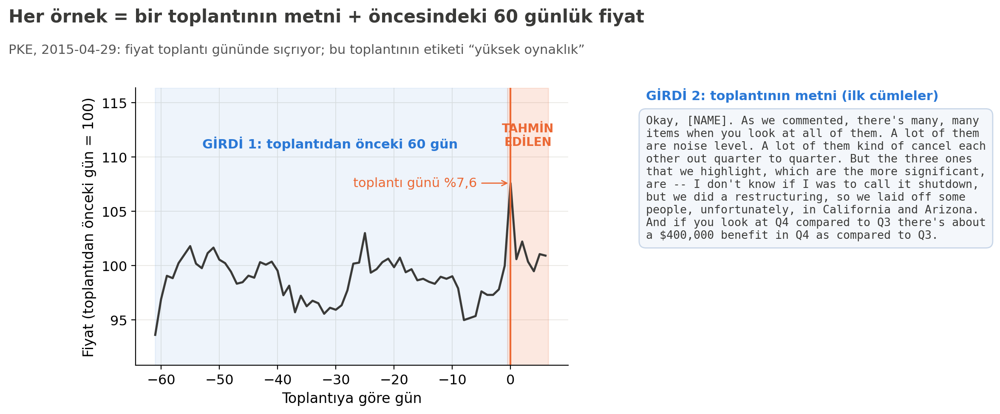

Bu grafik tek bir örneği gösteriyor. Solda toplantıdan önceki 60 günün fiyatı (girdi 1), sağda toplantının metni (girdi 2),
turuncu alan tahmin etmeye çalıştığımız 7 gün. Bu örnekte fiyat toplantı günü %7,6 sıçradı; etiketi "yüksek oynaklık".

**Neden iki tür veri birlikte?**
- **Fiyat geçmişi** hissenin ne kadar "hareketli" olduğunu söyler ama toplantıda ne konuşulduğunu bilmez.
- **Metin** ne konuşulduğunu söyler ama hissenin normalde ne kadar hareketli olduğunu bilmez.
- İkisi birbirini tamamlıyor; kanıtı Bölüm 6'da.

**Hedef (etiket) nasıl hesaplanıyor?** Toplantı günü dahil 7 günde, fiyatın günlük değişimlerinin ne kadar dağınık olduğu
ölçülür (standart sapma). Sonra toplantılar üçe bölünür: en sakin üçte bir "düşük", ortası "orta", en hareketli üçte bir
"yüksek". Sınırlar yalnız eğitim verisinden belirlendi.

**Neden toplantı günü dahil 7 gün?** Bazı toplantılar borsa açılmadan, bazıları kapandıktan sonra yapılıyor; tepki ya o gün ya
ertesi gün geliyor, ikisini de kapsıyoruz. Girdi ise toplantıdan bir önceki günde bitiyor: modele gelecekten bilgi gitmiyor.

---

## 2. Veri nereden geldi? (Kriter 2)

| Veri | Kaynak | Sürüm | Lisans |
|---|---|---|---|
| Metin | [MAEC](https://github.com/Earnings-Call-Dataset/MAEC-A-Multimodal-Aligned-Earnings-Conference-Call-Dataset-for-Financial-Risk-Prediction) (Li vd., 2020) | commit `65a109f` | CC BY-SA 4.0 |
| Fiyat | [FNSPID](https://huggingface.co/datasets/Zihan1004/FNSPID) (Dong vd., 2024), yalnız fiyat dosyaları | revizyon `bf9189c` | CC BY-NC 4.0; kaynağı Yahoo Finance |
| Duygu sözlüğü | [Loughran–McDonald](https://sraf.nd.edu/loughranmcdonald-master-dictionary/) finans sözlüğü | 1993–2025 | Akademik kullanım ücretsiz |
| Şirket adı, sektör | SEC (ABD borsa kurumu) sitesinden kendimiz çektik | Kasım 2026 | Kimlik bildirerek, saniyede en çok 10 istek |

- **Nasıl indirildi?** Kod veriyi sabit bir sürümden indiriyor ve dosyaların değişmediğini "parmak iziyle" (SHA256) kontrol ediyor.
- **Karşılaşılan sorunlar:** fiyat dosyalarında tarihler ters sıralıydı, sütun sırası dosyadan dosyaya değişiyordu, 7.694
  gereksiz kopya dosya vardı, bazı fiyat dosyaları yarımdı. Hepsi kodda düzeltildi.
- **Lisans ve etik:** veri bu depoya konmadı, yalnız indiren kod paylaşıldı. Metinlerde kişi adları gizlenmiş.
- **Eşleştirme kuralı:** her toplantının kimliği `TARİH_HİSSEKODU` (ör. `20150429_PKE`); fiyat dosyası aynı hisse koduyla bulunuyor.

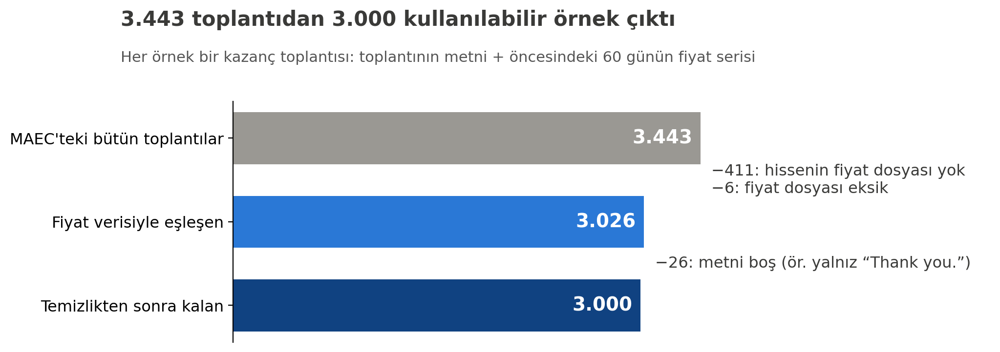

Toplantıların çoğu fiyatla eşleşti. Kaybın neredeyse tamamı, fiyat dosyası hiç olmayan hisselerden.

---

## 3. Ne kadar veri var, dengeli mi? (Kriter 3)

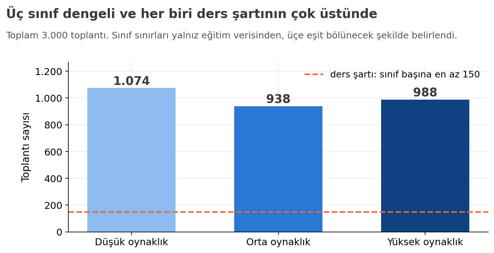

Ders şartı (en az 3 sınıf, sınıf başına en az 150, toplam en az 500) rahatça sağlanıyor.

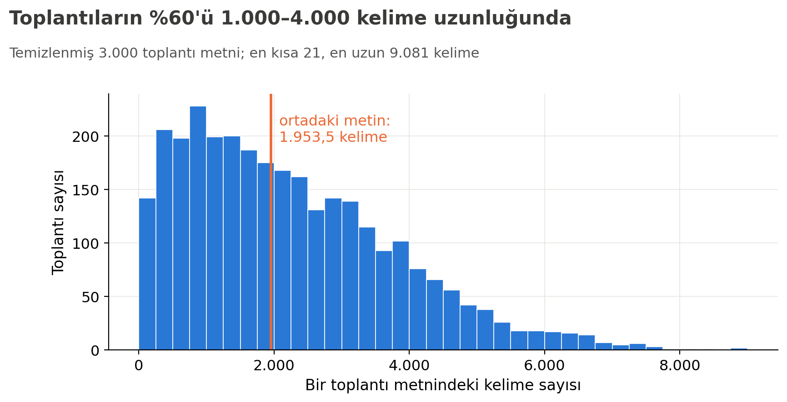

Metinler uzun; çoğu 1.000–4.000 kelime. Yalnız "Thank you." gibi içi boş metinler çıkarıldı. Fiyat serisi ise her örnekte
tam 60 gün; hiç eksik gün yok.

**Olası yanlılıklar:**
- Yalnız ABD'nin büyük şirketleri (S&P 1500) ve 2015–2018 dönemi var.
- Bazı sektörler daha kalabalık (en büyüğü imalat, %31,8).
- Sonradan borsadan çıkan şirketler eksik kalmış olabilir: eşleşmeyen 158 şirketin 116'sı bugün listede yok.
- Aynı şirketin birden çok toplantısı var; bu yüzden veriyi şirkete göre böldük (Bölüm 7).

---

## 4. Metin ve fiyat doğru eşleşti mi? Etiketler güvenilir mi? (Kriter 4)

**Eşleştirme:** hisse kodu + toplantı tarihi. Her toplantıya tam bir fiyat penceresi düşüyor.

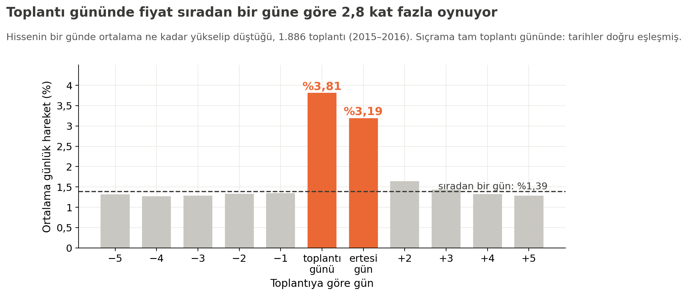

Tarihler doğru eşleştiyse fiyat tam toplantı gününde sıçramalı. Öyle de oluyor: toplantı günü ve ertesi gün hareket
sıradan bir günün yaklaşık 2–3 katı. Toplantıdan önceki gün ise normal: modele gelecekten bilgi sızmıyor.

**Ek kontrol:** SEC'ten aldığımız şirket adı, toplantı metinlerinin %64,1'inde geçiyor. Rastgele başka bir şirketin adı ise
yalnız %3,7'sinde geçiyor. Yani metinler doğru şirkete ait.

**Etiketler:** etiketi insan vermiyor, fiyattan formülle hesaplanıyor. Bazı toplantılar iki sınıfın tam sınırında
(%23,6'sı sınıra çok yakın); bu yüzden finalde sınıfın yanında sayısal değer tahmini (regresyon) de denenecek.

**Eksik veri:** metni eksik toplantı yok. 417 toplantının fiyatı yok ya da eksik; fiyat uydurulamayacağı için bunlar çıkarıldı.

---

## 5. Temizlik: önce ve sonra (Kriter 5)

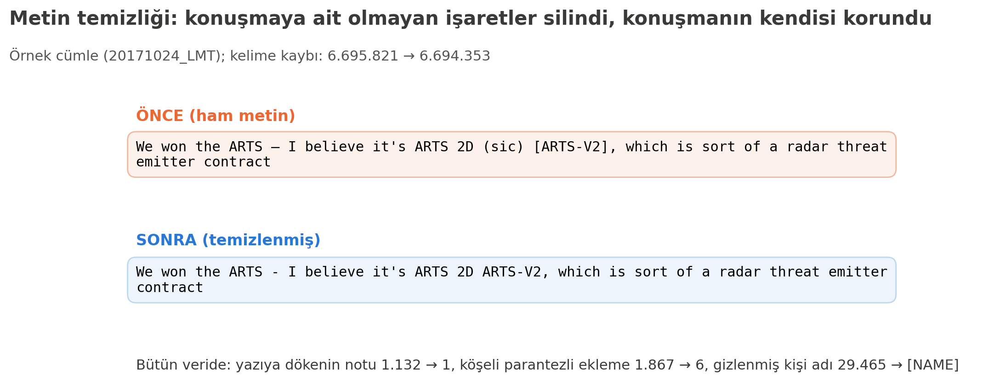

Metinden konuşmaya ait olmayan işaretler temizlendi: yazıya dökenin notları, köşeli parantezler, gizlenmiş isimler.
Konuşmanın kendisi korundu; kelimelerin neredeyse hepsi duruyor.

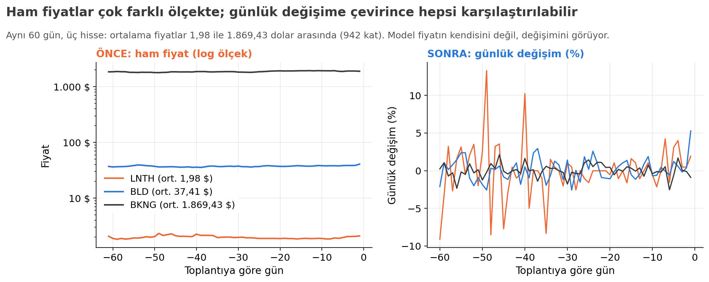

Hisse fiyatları birbirinden 942 kata kadar farklı. Model fiyatın kendisini değil **günlük değişimini** görüyor; böylece bütün
hisseler aynı ölçekte. (Ayrıca fiyatın kendisi sonradan düzeltildiği için gelecekten bilgi sızdırabilirdi.)

**Aykırı değerler:** çok büyük günlük hareketler (10 gün) tek tek incelendi. O günlerde işlem hacmi de patlamış, yani bunlar
gerçek haber tepkisi, veri hatası değil; silinmedi.

---

## 6. Veriyi inceleme: ne bulduk? (Kriter 6)

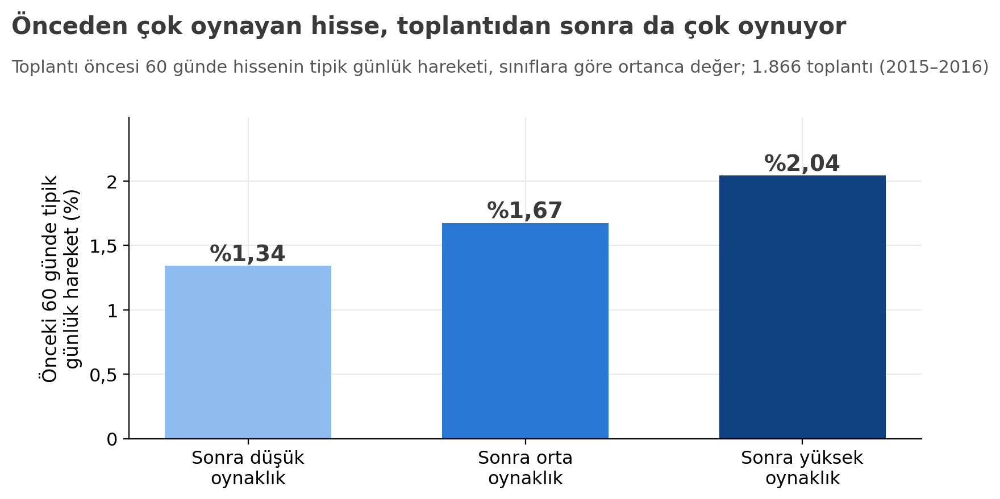

**Fiyat tarafı:** önceden hareketli olan hisse, toplantıdan sonra da hareketli. Bu güçlü bir ipucu.

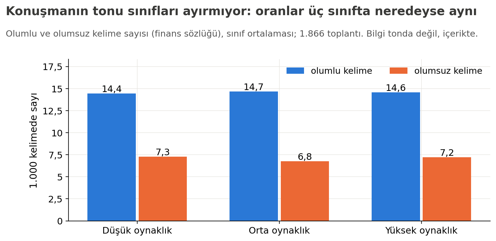

**Metin tarafı, ton:** konuşmanın olumlu/olumsuz tonu üç sınıfta neredeyse aynı. Yani ton tek başına bir şey söylemiyor.

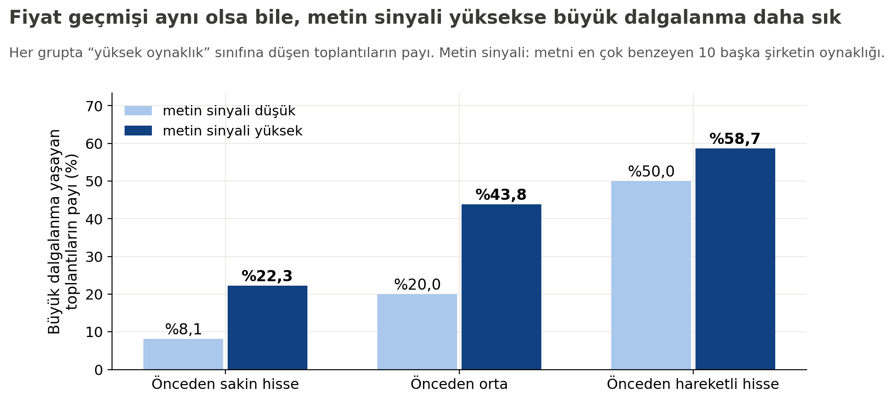

**Metin tarafı, içerik:** "Metin sinyali" = toplantı metnine en çok benzeyen 10 başka şirketin dalgalanması. Fiyat geçmişi
aynı olan hisseler arasında bile bu sinyal yüksekse büyük dalgalanma çok daha sık: önceden "orta" hareketli hisselerde
%20,0'dan %43,8'e çıkıyor. **Yani metin, fiyatın göremediğini görüyor; iki modalite birbirini tamamlıyor.** Bu sonuç 15 farklı
ayarla tekrar ölçüldü ve hepsinde aynı çıktı.

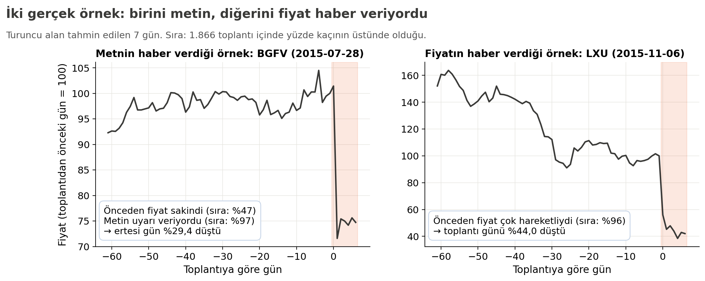

**İki gerçek örnek:** BGFV'de fiyat sakindi ama metin uyarı veriyordu; fiyat ertesi gün %29,4 düştü. LXU'da fiyat zaten çok
hareketliydi; toplantı günü %44,0 düştü. Birini metin, diğerini fiyat yakalayabilirdi.

**Güçlü yönler:** eşleşme doğrulandı, sınıflar dengeli, veri yeterli, iki modalite birbirini tamamlıyor.
**Sınırlılıklar:** ton işe yaramıyor; metin sinyalinin bir kısmı sektör bilgisi; dalgalanmanın bir kısmı genel piyasa
havasından geliyor; metin yalnız yöneticilerin konuşması; toplantı saati veride yok; yalnız ABD ve tek bir dönem.

---

## 7. Modele hazırlık: veriyi nasıl böldük? (Kriter 7)

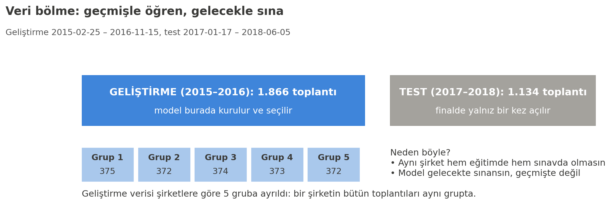

- **Neden rastgele bölmedik?** Aynı şirketin toplantıları birbirine benziyor; rastgele bölersek model şirketi ezberler. Ayrıca
  model gerçekte olduğu gibi gelecekte sınanmalı.
- Bir toplantının metni ve fiyatı **her zaman aynı grupta**.
- Sınıf sınırları ve ölçekleme gibi her şey **yalnız eğitim kısmından** öğreniliyor.
- **Modelin göreceği:** metin (temizlenmiş cümleler) + fiyat (60 gün × 3 bilgi: günlük değişim, işlem hacmi, gün içi fiyat
  aralığı) + etiket.
- **Finalde:** yalnız fiyat, yalnız metin ve ikisi birlikte (füzyon) modeller karşılaştırılacak; metnin katkısı bu farkla ölçülecek.

---

## 8. Kod (Kriter 8)

| Notebook | Ne yapıyor |
|---|---|
| `01_veri_edinme_eslestirme` | Veriyi okur, toplantıyı fiyatla eşleştirir, etiketleri hesaplar |
| `02_temizlik_on_isleme` | Metni ve fiyat serisini temizler, önce–sonra karşılaştırır |
| `03_kesifsel_analiz` | Ayrıntılı analizler ve istatistik testleri |
| `04_bolme_sizinti` | Eğitim/test bölmesi ve sızıntı kontrolü |
| `05_sunum_grafikleri` | Bu sayfadaki basit grafikler |

Ortak kod `src/`, bütün grafikler `sekiller/`, özet tablolar `cikti/` klasöründe. 24 kontrol testi geçiyor. Veri lisans
gereği depoda yok; `src/indir.py` aynı sürümü kaynağından indiriyor.

## Kaynaklar

- Li vd. (2020). MAEC: A multimodal aligned earnings conference call dataset for financial risk prediction. *CIKM*.
- Dong vd. (2024). FNSPID: A comprehensive financial news dataset in time series. *KDD*.
- Loughran ve McDonald (2011). When is a liability not a liability? *Journal of Finance*.
- Kogan vd. (2009). Predicting risk from financial reports with regression. *NAACL*.
- Qin ve Yang (2019). What you say and how you say it matters. *ACL*.
- Berkman ve Truong (2009). Event day 0? After-hours earnings announcements. *Journal of Accounting Research*.
